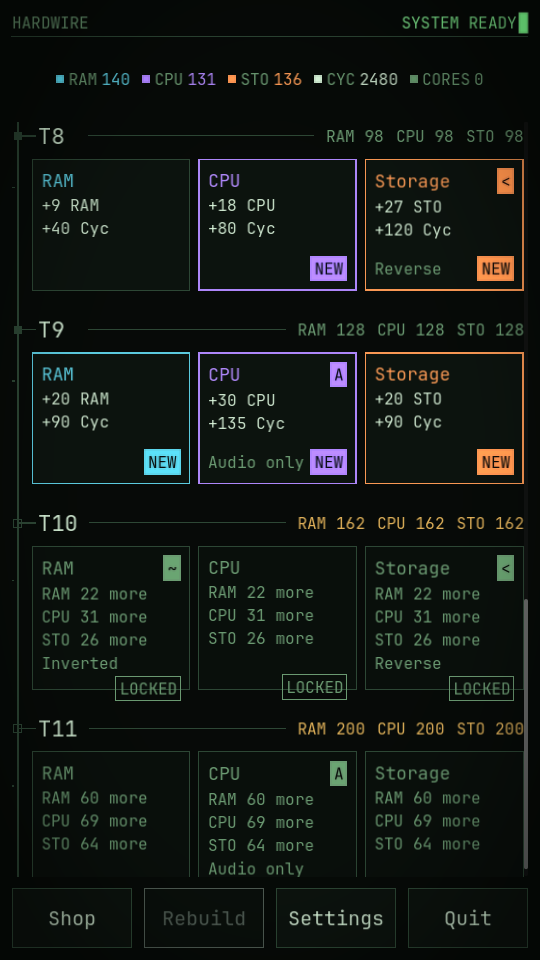
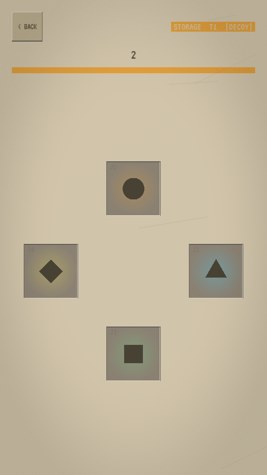
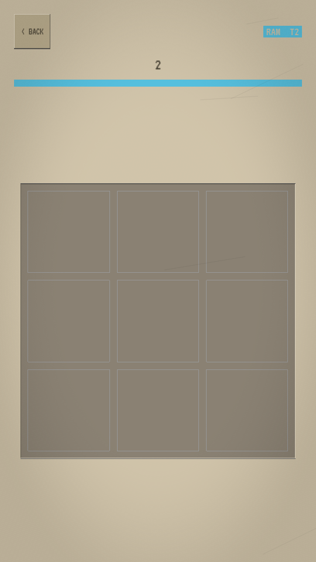
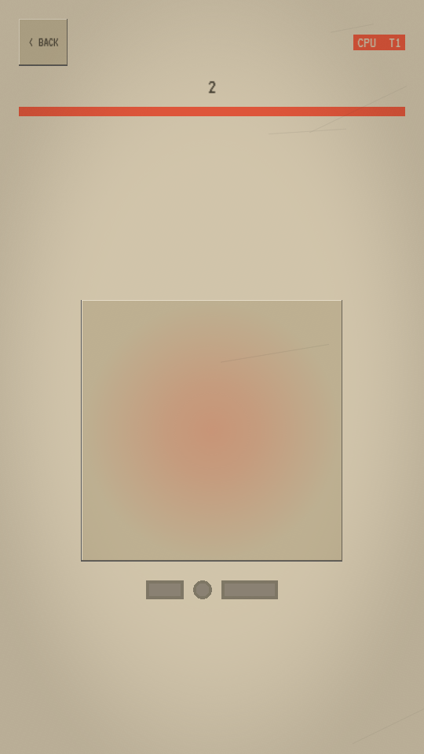

# Hardwire

[](https://github.com/Kymr10n/hardwire/actions/workflows/ci.yml)
[](LICENSE)
[](https://godotengine.org)

An endless incremental puzzle game for phones and the Steam Deck. Upgrade a computer by solving three short memory and timing minigames: each one raises a stat, and higher stats unlock harder puzzle slots that pay out more. Free and open source, with no ads, purchases or tracking.

| Overview | Storage | RAM | CPU |
| :---: | :---: | :---: | :---: |
|  |  |  |  |

## Status

Playable prototype (version 0.1.0). All three minigames, the tier overview, the upgrade shop, prestige ("Rebuild") and idle income are in. The web build runs; the Android build and testing on real phones are still to come. Progress per milestone is tracked in the [spec](docs/SPEC.md#milestones-and-acceptance-criteria).

## How it plays

- **Storage** (raises STO): pads light up in sequence; tap them back in order.
- **RAM** (raises RAM): a pattern flashes on a grid; recreate it from memory.
- **CPU** (raises CPU): the tile plays a rhythm; copy it by holding and releasing.
- Puzzles take 10 to 40 seconds. A failure costs nothing; a fresh sequence starts right away.
- Slots unlock only when every stat meets the requirement, so no minigame can be skipped. From tier 8, modifiers such as *Reverse*, *Rotated* or *Syncopated* change the rules.
- Spend Cycles on upgrades, Rebuild for permanent Cores, and collect idle Cycles when you come back.

The full design, including every formula, is in [`docs/SPEC.md`](docs/SPEC.md). Every tuning number lives in [`data/balance.json`](data/balance.json).

## Run it

Requirements: [Godot 4.7.2](https://godotengine.org/download) (standard build, not .NET), with `godot` on your PATH.

```bash
git clone https://github.com/Kymr10n/hardwire.git
cd hardwire
godot --headless --path . --import   # first run: import assets
godot --path .                        # play in a 1280x800 window (Steam Deck size)
```

Use the mouse as your finger (touch is emulated), or a gamepad / keyboard: D-pad or arrows move the focus, A / Enter / Space selects (and is the CPU tile), B / Esc goes back, Y / C commits a RAM pattern. Make the window taller than wide to get the phone layout. In debug builds, tap the stat bar 5 times to open the debug panel, where you can set stats and tiers and force a minigame or modifier.

## Develop

Requirements: Godot 4.7.2 and Python 3 (for gdtoolkit). GUT is vendored in `addons/gut`.

```bash
tools/setup.sh       # once: gdtoolkit (gdformat, gdlint) into .venv, version checks
tools/check.sh       # the quality gate: format, lint, drift checks, script errors, tests
godot -e --path .    # open the editor
```

`tools/check.sh` is the same gate CI runs. Its drift checks keep code, tests and docs consistent: every `logic/` file has a mirrored test in `tests/logic/`, no tuning numbers in game logic, no duplicated blocks, short functions, input only through InputMap actions. VS Code users get tasks for the gate, for running the game as Steam Deck or phone, and for deploying to a Steam Deck.

| Path | Contents |
| --- | --- |
| `docs/SPEC.md` | Game design spec: source of truth, milestones, acceptance criteria |
| `docs/DECISIONS.md` | Why the spec is what it is (append-only decision log) |
| `docs/PROGRESS.md` | Milestone status and play-test notes |
| `data/balance.json` | Every tuning number, read through the `Balance` autoload |
| `autoload/` | Singletons: Balance, GameState, SaveManager, InputMode (glyphs), Synth (generated audio), Haptics |
| `logic/` | Pure, unit-tested rules: generators, rhythm judge, economy, progress |
| `scenes/` | Main scene, screens, the three puzzles, UI components (built in code with `Ui` helpers) |
| `theme/` | Colors, sizes and durations |
| `tests/` | GUT tests; `tests/logic/` mirrors `logic/` |
| `tools/` | Setup, quality gate, drift checks, exports, Steam Deck deploy, pinned versions |

See [CONTRIBUTING.md](CONTRIBUTING.md) before opening a pull request.

### Working with Claude Code

The project is developed with [Claude Code](https://claude.com/claude-code) under a small harness. [`CLAUDE.md`](CLAUDE.md) holds the rules (KISS, DRY, YAGNI, architecture, platforms, tests), which apply to human contributors too.

| What | How |
| --- | --- |
| Build the next milestone | `/milestone M#`: plan, tests first, minimal code, gate, review, progress, commit |
| Change the design | `/spec-change <what and why>`: decision record, spec, data, tests and code together |
| Review ad-hoc changes | `/review`: the gate plus the read-only `reviewer` and `spec-auditor` agents |

Hooks in `.claude/settings.json` protect generated files and past decisions, format and lint every edit, and run `tools/check.sh` before Claude finishes a turn.

## Export

Presets for Linux (Steam Deck), Windows, macOS, Android and Web are in `export_presets.cfg`. Install the Godot 4.7.2 export templates first (Editor → Manage Export Templates).

```bash
tools/export.sh Linux build/linux/hardwire.x86_64   # Linux / Steam Deck (single file, PCK embedded)
tools/export.sh Windows build/windows/hardwire.exe  # Windows (single file)
tools/export.sh macOS build/macos/hardwire.zip      # macOS (unsigned; signing needs a Mac)
tools/export.sh Web build/web/index.html            # Web (single-threaded; serve over HTTPS or localhost)

# Android (needs the Android SDK and JDK 17 in Editor Settings → Export → Android)
godot --headless --path . --export-debug "Android" build/android/hardwire.apk
```

CI builds the Linux, Windows and web exports on every push to `main` and attaches them as artifacts.

### Steam Deck

`tools/deck.sh` exports the Linux build and copies it to `~/Games/hardwire/` on the Deck over SSH. The target is `$DECK`, or `DECK=...` in the git-ignored `tools/deck.local.env`, default `deck@steamdeck`. `--run` also starts the game there (desktop mode); `--no-export` copies the existing build. One-time setup:

1. On the Deck in desktop mode, open Konsole: `passwd` (set a password), then `sudo systemctl enable --now sshd`.
2. On the dev PC: `ssh-copy-id deck@steamdeck` and, if the Deck has another address, `echo 'DECK=deck@<host-or-ip>' > tools/deck.local.env`.
3. Run `tools/deck.sh` once. On the Deck in desktop mode: Steam → Add a Game → Add a Non-Steam Game → browse to `~/Games/hardwire/hardwire.x86_64`.

After that the loop is: edit, `tools/deck.sh` (or the VS Code task "Deploy: Steam Deck"), press Play in game mode. Steam sets `SteamDeck=1`, so the game starts fullscreen. For log output, run the binary over `ssh` while the Deck is in desktop mode.

Without SSH:

1. Get `hardwire.x86_64` (export it as above, or download the `hardwire-linux` artifact from a CI run).
2. On the Deck, switch to Desktop Mode and copy the file anywhere, for example `~/Games/hardwire/`. Make it executable: right-click → Properties → Permissions → "Is executable" (or `chmod +x hardwire.x86_64`).
3. In Steam (Desktop Mode): Games → "Add a Non-Steam Game to My Library…" → browse to the file.
4. Switch back to Game Mode and start Hardwire from your library. It starts fullscreen (Steam sets `SteamDeck=1`) and plays with touch or the built-in controls. In the game's Steam controller settings, pick the "Gamepad" layout if it isn't the default.

## License

Hardwire is released under the [MIT License](LICENSE). It uses the Godot Engine (MIT), the JetBrains Mono font (SIL Open Font License 1.1) and, for tests only, GUT (MIT); see [THIRD_PARTY_NOTICES.md](THIRD_PARTY_NOTICES.md). The game lists all license texts under Settings → Licenses.
